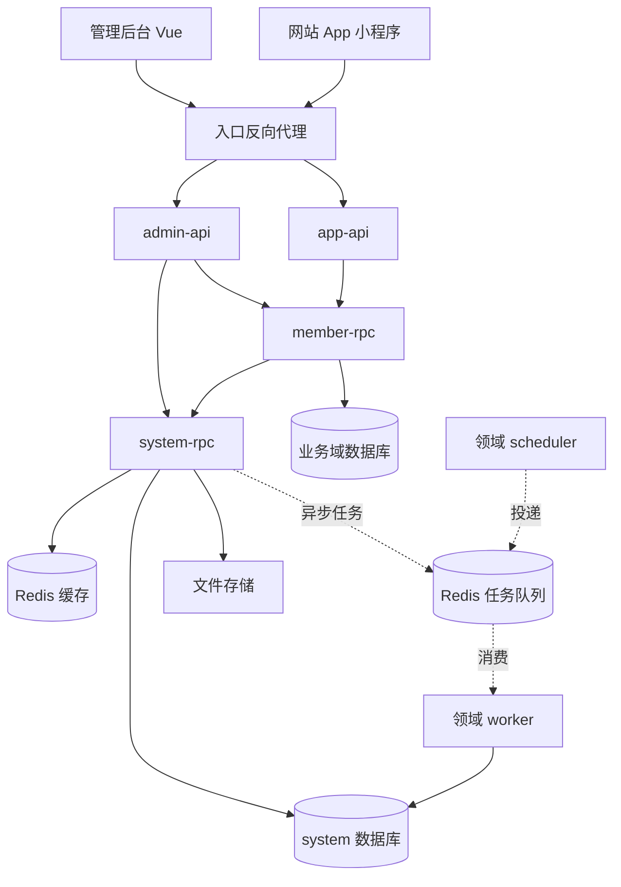

# GoSeed 整体架构

GoSeed 面向需要业务 API 和管理后台的 Go 项目，采用单仓库、单 Go module、多个独立服务进程的结构。工程骨架、认证授权、文件与异步任务已接入；跨领域管理员授权已通过 system CheckAccess 接入；下文仍包含后续扩展目标，实现状态以 README 和 roadmap 为准。

本文是实现基线；当前能力与具体限制以实施路线及[文件与任务](files-and-tasks.md)为准。目录与生成命令见[目录规范](directory-structure.md)和[开发约定](development-guide.md)。

## 设计决策

| 项目 | 第一版选择 | 原因与边界 |
| --- | --- | --- |
| 仓库组织 | Monorepo，根目录一个 `go.mod` | 统一依赖、生成与联调；每个进程独立构建镜像 |
| 服务形态 | 两个 HTTP API、system/member RPC 与 system worker/scheduler | 管理端与业务端分别演进；系统基础能力集中维护 |
| 业务拆分 | 按业务域拆，域内按模块组织 | 用户、角色、菜单不分别拆微服务；商品、订单按实际业务增加 |
| HTTP 与 RPC | go-zero REST、zrpc | 保留原生生成目录与服务治理能力 |
| 数据访问 | 默认 GORM | 便于关联查询、后台 CRUD 与现有经验复用；需要 sqlx 的服务单独决策 |
| 数据库 | 第一版以 MySQL 为验收基线 | PostgreSQL 在补齐迁移和集成测试后再宣布支持 |
| 权限 | system 内集中使用 Casbin | 外部服务通过授权接口查询，避免每个 API 都维护一份策略 |
| 任务 | Asynq，按业务域划分 worker | 任务业务与同步业务共用所属领域的 application 层 |
| 前端 | Vue 3、TypeScript、Element Plus | 默认延续 Backplane 主线的 UI 体系；首版维护一套组件库 |
| 服务发现 | 配置直连 | 开发用 localhost，Compose 用服务名；扩容后再选择动态发现 |
| 部署 | Compose，前端静态部署 | 先完成小规模交付；单二进制与 Kubernetes 模板后续按需增加 |

go-zero 的原生结构包含 handler、logic、svc 等职责层，GoSeed 在其外侧增加领域内共享代码，不另写一套 HTTP/RPC 框架。[go-zero 项目结构](https://go-zero.dev/concepts/project-structure/)

## 系统视图



图中的 worker 是 system 领域示例，其他领域的 worker 只访问自己的数据库。虚线表示按业务启用的组件或调用；member-rpc 已作为当前运行栈的一部分。

反向代理承担 TLS、静态资源和路由转发。`admin-api`、`app-api` 是面向客户端的接口聚合层，负责协议适配、参数校验和 RPC 编排。API 不持有业务表的数据库连接，业务事务放在 RPC 所属领域。

## 服务边界

| 进程 | 职责 | 数据与依赖 |
| --- | --- | --- |
| `admin-api` | 管理端 HTTP 接口、JWT 初步校验、响应映射、后台接口聚合 | system 与业务 RPC 客户端；必要的限流缓存 |
| `app-api` | 面向终端用户的业务 HTTP 接口 | 对应业务 RPC；独立的认证与限流规则 |
| `system-rpc` | 管理员认证、会话、角色、权限、菜单、字典、配置、文件元数据、审计 | system 数据库、Redis、存储适配器、任务生产者 |
| `system-worker` | 导出、清理及其他 system 异步任务 | system 数据库、任务队列、存储适配器 |
| `system-scheduler` | 投递 system 的周期任务 | 调度配置与队列客户端；不初始化整套后台依赖 |
| `member-rpc` | 会员注册登录、资料、会话、后台查询与启停 | 独立 member 数据库、Redis、system 授权 RPC |
| `<domain>-rpc` | 后续独立领域的业务用例 | 自己的数据库；必要的基础能力 RPC |
| `<domain>-worker` | 本领域异步用例 | 本领域内部代码与数据库 |

`system-rpc` 只接纳通用管理能力。商品、订单等业务不能因为管理后台要操作它们，就写进 system。system 也不反向调用各业务域，避免依赖环。

第一版 system 的账号是**管理员账号**。业务会员由 member 领域负责，已实现独立的 JWT kind、issuer、audience、密钥、数据库账号和会话规则。`app-api` 提供会员注册、登录与自己的资料接口。

## 代码分层

同步调用遵循：

```text
HTTP handler → API logic → RPC client
                            ↓
                    RPC server → RPC logic → application → repository → MySQL
                                                  ↑
                                           worker handler
```

- **handler/server**：处理协议输入输出，保持生成结构稳定。
- **API logic**：DTO 转换、有限的接口聚合、错误映射，不执行数据库事务。
- **RPC logic**：调用 application、转换协议类型，不承载可复用的领域规则。
- **application**：一个业务用例的规则、授权、事务及任务协调；同时供 RPC 与 worker 使用。
- **repository/model**：查询、持久化和 GORM 映射，只属于一个领域。
- **ServiceContext**：每个进程的依赖装配入口。资源按需创建，通过构造函数注入，不使用 `app.DB`、全局 Enforcer 等可变单例。

简单 CRUD 直接实现 application 方法，不额外增加一组没有行为的 domain、manager、service 转发层。仓储接口按实际调用需要定义，不要求每张表都配通用 Repository 接口。

## 认证与授权

### 请求链路

1. `system-rpc` 完成管理员登录，签发短期 access token，维护 session 与可轮换的 refresh token。
2. `admin-api` 验证 access token 的签名、算法、有效期、issuer、audience 和主体类型，构建类型明确的身份上下文。
3. API 调用 RPC 时使用服务身份凭证，并传递原始用户 token、请求标识及 Trace 上下文。浏览器传入的 `X-User-ID`、角色或内部 metadata 不能作为可信身份。
4. system 内的用例直接调用本地授权器，校验账号状态、session、token version 和权限。其他领域接入时通过已实现的 system `CheckAccess` 做同等校验，再检查本领域的数据归属。
5. 权限名由 RPC 用例确定，例如 `member.user.update_status`；调用方不能通过传一个较弱的权限名来绕过检查。

API 的 JWT 校验是入口检查，RPC 是业务授权的最终边界。第一版不在每层重复做相同的远程权限预检。公开方法采用明确的白名单，默认方法要求授权；system 的认证基础方法使用独立的服务调用权限，避免授权接口递归调用自身。

服务身份与用户身份分开：生产环境使用经过验证的 TLS 连接和可轮换的每服务凭证，并限制服务可调用的方法；开发环境可在本机隔离网络内简化传输配置。仅部署在内网不构成身份验证。

go-zero 的 JWT 中间件不会把所有标准 claims 直接放进 context。GoSeed 的认证适配器必须显式处理完整 claims，不能假设通过 `ctx.Value("sub")` 就能取得用户。[JWT 中间件源码](https://github.com/zeromicro/go-zero/blob/master/rest/handler/authhandler.go)

### 会话撤销与权限一致性

第一版优先保证撤销行为可解释：授权器从主库读取账号状态、token version、session 状态和当前策略版本，不缓存最终的允许结果。禁用用户、改密或注销提交后，新授权检查必须拒绝旧会话；已经通过检查的在途请求不做追溯取消。

用户角色归属、角色权限关联等授权变更与策略版本在同一个数据库事务内更新。关系表是授权事实的唯一来源，Casbin 内存策略由它们构建；避免同时维护关系表与另一套独立写入的 `casbin_rule` 数据。加载器读取同一数据库快照中的关系与版本，构建新 Enforcer 后原子替换。

每次授权先比较数据库策略版本与实例已加载版本，不一致则加载再判断，加载失败拒绝授权。当前每次请求确认主库版本，不依赖 Redis 通知或定期重载。未来通知可用于提前刷新，但通知丢失不能让旧策略继续授权。后续需要减少数据库查询时，必须先定义可接受的撤销延迟，再引入缓存。

Casbin 的 Watcher 能通知其他实例更新策略，但持久化与漏通知恢复仍需要应用设计。[Casbin Watchers](https://casbin.apache.org/docs/watchers/)

refresh token 仅存摘要，刷新采用原子轮换，旧 token 重用触发该 session 撤销。管理员账号、角色、超级管理员状态的变更都需服务端检查授权范围，不能只依靠菜单隐藏。

### 权限与菜单

权限采用稳定的 `域.资源.动作`，例如 `system.user.read`。HTTP 路由模板、RPC 用例和前端按钮均关联这个权限，菜单本身只是导航。

每个领域维护 `resources/permissions.yaml`，管理端维护菜单声明和页面组件白名单。显式同步命令把声明更新到 system 的权限目录；它不会覆盖管理员配置的角色授权，也不会默认把新权限授予普通角色。内置 super_admin 拥有所有有效目录权限，是明确的例外。同步前校验权限引用、路由覆盖和重复键。

## 数据与事务

第一版使用一个 MySQL 实例，按领域分逻辑数据库，例如 `goseed_system`、`goseed_member`，数据库账号按领域授权。领域间只保留业务 ID，不建跨库外键、跨域 Join 或直接更新其他服务的表。

事务由 application 发起，repository 使用传入的事务对象或明确的事务作用域。HTTP context、数据库事务、分布式事务是三个不同概念，事务不能跨 RPC 延续。聚合查询由 API/RPC 调用组成；高成本的跨域报表后续建立只读投影。

迁移采用版本化 SQL 与 goose，由独立的部署任务执行。生产启动不自动执行 GORM AutoMigrate；迁移和 bootstrap 分开，bootstrap 可重复运行且不重置现有密码。DDL 先兼容旧代码，再滚动发布，最后清理旧结构。goose 支持 SQL 与 Go 迁移，具体回滚仍须按所用数据库验证。[goose](https://github.com/pressly/goose)

所有服务默认使用 GORM。确有 SQL 或生成缓存 Model 需求时，可以为整个服务选择 go-zero sqlx；同一张表不同时维护两套写入和缓存策略。首版不强制提供双 ORM 模板。

## 配置与缓存

- **启动配置**：各进程的 `etc/*.yaml`，通过 `conf` 加载，环境变量注入凭证；覆盖优先级由配置模板和装配代码明确实现。
- **运行时配置**：system 数据库中的命名配置，通过 RPC 获取；敏感项限制读取，不能整体下发给前端。
- **缓存**：采用 `goseed:<env>:<domain>:<purpose>:<id>` 命名。普通配置允许通知刷新加最长 30 秒 TTL；涉及授权或安全的配置直接读取权威状态。
- **Redis 隔离**：开发可共用实例；生产队列与可淘汰缓存分别部署。队列开启持久化，使用不随意淘汰任务数据的内存策略。

优先使用 go-zero 的 Redis、limit 等基础组件；Asynq 使用自身支持的连接方式。包装只用于统一超时、命名和生命周期，不重新定义一整套 Redis SDK。

## 异步任务与审计

Asynq 按至少一次执行设计，消费者必须可重入。`Unique` 和调度单实例都不能替代业务幂等。[Asynq 功能说明](https://github.com/hibiken/asynq#features)

任务属于业务域，任务类型带版本，例如 `system.export_users.v1`。队列隔离环境与领域，worker 只消费自己声明的队列。payload 保存业务 ID、任务 ID、发起人标识和 Trace 信息，不保存密码或长期用户 token；敏感的延迟操作执行前重新检查当前授权。

当“业务提交成功就必须执行任务”时，在同一数据库事务写入业务记录和 outbox，由所属领域 worker 的投递循环可靠投递，成功后标记。消费者通过数据库唯一键或状态转换保证重复投递不重复产生副作用。普通可丢失通知可以直接入队，但必须明确其容错语义。

每个领域的 scheduler 初期只运行一份，升级时避免旧新实例重叠；任务仍以“调度项 ID + 计划执行时间”建立业务唯一键。记录失败原因、重试次数、最终状态，提供人工重试入口及权限校验。

审计分为访问记录与业务审计。当前改权限、禁用账号等 system 关键操作已在本地事务中记录[操作日志](operation-audit.md)；其他领域先可靠保存自己的审计事件，再投递到 system 汇总，按事件 ID 去重。访问日志不替代业务审计，禁止记录密码、完整 token 和未脱敏敏感正文。

## 文件与管理后台

文件元数据、所有者和访问规则由 system 管理；`pkg/storage` 仅提供文件读写接口与实现。开发可用本地目录，多副本部署使用 S3 兼容存储。采用上传凭证或流式上传，避免把大文件转成 protobuf 字节串传过所有服务。上传完成后验证大小、类型和对象归属。

管理后台按 `features/<domain>/<module>` 组织页面、请求适配和路由。公共表格、表单、分页与权限组件放在共享目录，业务逻辑留在 feature。TypeScript API 类型由契约派生，前端不能直接依赖数据库模型或 protobuf 类型。

当前服务端返回权限集合，菜单声明在构建时编译，前端用组件白名单解析菜单。未来动态菜单也不得执行服务端传来的任意脚本。按钮权限控制交互体验，RPC 仍校验权限。前端默认独立构建并由反向代理提供 `/admin/` 静态资源；将来可提供 embed 交付方式。

## 部署与可观测性

| 组件 | 本地默认端口 | 部署要求 |
| --- | --- | --- |
| 统一入口 | `8088` | `/admin/` 静态页，`/admin-api/` 转发管理 API，`/api/` 转发业务 API |
| admin-api | `8081` | 可多副本，不对外暴露管理用指标端口 |
| app-api | `8080` | 可多副本，独立于管理端发布 |
| system-rpc | `19001`（容器内 `9001`） | 只对受信服务开放，配置服务身份校验 |
| member-rpc | `19002`（容器内 `9002`） | 独立会员领域，仅向受信 API 提供业务方法 |
| 前端开发服务 | `5173` | 开发代理转发 API |

完整开发环境由两个 API、system/member RPC、system worker/scheduler、MySQL、Redis 和前端组成。仅开发系统后台时可以省略 app-api。运行时继续使用 RPC 边界，不维护另一套通过配置切换的进程内调用模式。

RPC 初期使用 `Endpoints`；go-zero 也提供 `Target` 与 etcd 配置，后续根据部署平台选择发现机制。单 Go module 不妨碍各进程分别执行 `go build` 和发布镜像。[RPC 配置源码](https://github.com/zeromicro/go-zero/blob/master/zrpc/config.go)

每个进程输出 logx 结构化日志，关联 request ID、Trace ID、服务名和安全的业务标识。监控 HTTP/RPC 延迟与错误、数据库池、队列积压、任务重试和策略刷新失败。HTTP 提供 `/healthz` 与 `/readyz`，RPC 接入健康检查；依赖未准备好时不接流量。退出时先停止接新请求和调度，再排空在途操作并关闭资源。

同步请求显式设置超时预算，例如 HTTP 3 秒、下游 RPC 2 秒、单次数据库操作 1 秒，实际值通过配置与压测调整。多段调用共享剩余 deadline，写请求不透明重试；长任务返回任务 ID，由客户端查询进度。

## 后续扩展边界

多租户、会员体系、支付、Kafka、分布式事务协调器、服务网格及 Kubernetes 均按真实业务引入。没有 tenant ID 贯穿身份、存储和授权之前，不声称支持多租户；通用后台不会自动具备业务数据隔离能力。

架构变化优先调整领域边界与契约。仅当团队、依赖或发布节奏要求独立版本时，才把服务移成单独 Go module，并将公开 RPC 契约抽成版本化模块。
